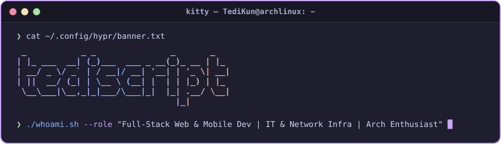
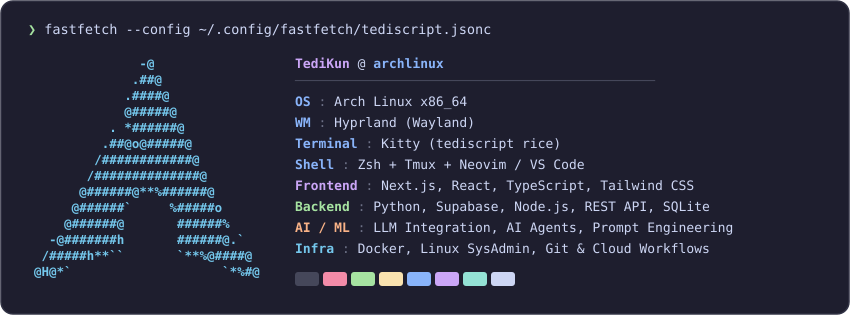

# PRD: GitHub Profile README (`TediKun/TediKun`)

## 1. Project Overview
- **Repository Target:** `TediKun/TediKun` (GitHub Special Profile Repository)
- **Primary Language:** English (100% of UI text, SVG labels, badges, tables, and logs must be written in English)
- **Visual Concept:** Arch Linux + Hyprland + Kitty Terminal Workspace (`tediscript` rice) combined with `fastfetch` system info and `btop` monitoring widgets.
- **Color Palette:** **Catppuccin Mocha**
  - Base Background: `#1e1e2e`
  - Mantle / Darker Surface: `#181825`
  - Surface0 (Borders/Lines): `#313244`
  - Surface1: `#45475a`
  - Text Primary: `#cdd6f4`
  - Subtext0: `#a6adc8`
  - Mauve (Primary Accent): `#cba6f7`
  - Blue: `#89b4fa`
  - Sapphire: `#74c7ec`
  - Teal: `#94e2d5`
  - Green: `#a6e3a1`
  - Peach: `#fab387`
  - Yellow: `#f9e2af`
  - Red: `#f38ba8`

---

## 2. Strict AI Agent Execution Rules
1. **No Scope Creep / No AI Slop:** Build ONLY the files, sections, projects, and tech stack specified in this PRD. Do not invent extra sections, dummy repositories, or unapproved color themes.
2. **Exact Asset Parity:** Use the exact SVG structures, hex codes, usernames (`TediKun`), and project entries defined in Section 5.
3. **Phased Execution & Stop-and-Wait Gate:**
   - Execute strictly one phase at a time in sequential order (`Phase 1` -> `Phase 2` -> `Phase 3`).
   - After completing all tasks in a phase, **STOP**, summarize what was created/verified, and wait for explicit user approval before starting the next phase.

---

## 3. Target File Architecture
```text
TediKun/
├── .github/
│   └── workflows/
│       ├── snake.yml
│       └── wakatime.yml
├── assets/
│   ├── header.svg
│   └── fastfetch.svg
├── PRD.md
└── README.md
```

---

## 4. Phased Implementation Plan & Checklists

### Phase 1: Custom Terminal SVG Assets (`assets/`)
**Objective:** Create two responsive (`viewBox="0 0 850 ..."`), self-contained animated SVG graphics matching the Kitty terminal and `fastfetch` aesthetic in Catppuccin Mocha colors.

- [ ] **Task 1.1:** Create directory `assets/` if it does not exist.
- [ ] **Task 1.2:** Create `assets/header.svg` using the exact XML blueprint in Section 5.1 (Kitty terminal window frame, animated Catppuccin gradient ASCII banner for `tediscript`, and blinking cursor prompt).
- [ ] **Task 1.3:** Create `assets/fastfetch.svg` using the exact XML blueprint in Section 5.2 (Arch Linux ASCII logo with subtle opacity pulse on the left, `TediKun@archlinux` environment specs and Catppuccin color swatches on the right).

> **Phase 1 Validation Gate:** Verify both SVG files contain valid XML syntax without broken tags, then **STOP and wait for user confirmation**.

---

### Phase 2: GitHub Actions Automation (`.github/workflows/`)
**Objective:** Configure automated daily contribution snake generation and safe conditional weekly WakaTime stats updates.

- [ ] **Task 2.1:** Create `.github/workflows/snake.yml` using the exact YAML specification in Section 5.3 (`Platane/snk/svg-only@v3` pushing to `output` branch with Catppuccin Mocha snake & dot colors).
- [ ] **Task 2.2:** Create `.github/workflows/wakatime.yml` using the exact YAML specification in Section 5.4 (guarded by `if: ${{ secrets.WAKATIME_API_KEY != '' }}` so it never fails before the secret is added).

> **Phase 2 Validation Gate:** Verify valid YAML indentation and action versions, then **STOP and wait for user confirmation**.

---

### Phase 3: Main Profile Layout (`README.md`)
**Objective:** Assemble the complete `README.md` connecting the custom SVGs, CLI social links, `btop` stats, `tree ./tech-stack`, `docker ps` project table, and WakaTime log section.

- [ ] **Task 3.1:** Create `README.md` using the exact Markdown & HTML structure in Section 5.5, including:
  - Centered `assets/header.svg` and `assets/fastfetch.svg`.
  - Centered CLI social flag badges (`--portfolio`, `--tribook`, `--linkedin`, `--email`, and `--views` counter).
  - `### ❯ btop --monitor contributions & stats` with Contribution Snake `<picture>`, 30-Day Activity Graph, Streak Stats, GitHub Stats, and Top Languages card.
  - `### ❯ tree ./tech-stack` grouped into `frontend-mobile/`, `backend-database/`, and `devops-sysadmin/`.
  - `### ❯ docker ps --format "table {{.Names}}\t{{.Image}}\t{{.Status}}"` listing `tribook-web`, `coolinvest-app`, `tediscript-portfolio`, `pra-coffe-pos`, `habit-rpg-android`, and `expense-tracker-app`.
  - `### ❯ tail -f /var/log/wakatime.log` with `<!--START_SECTION:waka-->` and `<!--END_SECTION:waka-->` markers.

> **Phase 3 Validation Gate:** Confirm all 5 project files exist, no broken relative paths remain, and provide post-setup instructions for enabling GitHub Actions `Read and write permissions` in repository settings.

---

## 5. Exact File Specifications

### 5.1 `assets/header.svg`
```xml
<svg xmlns="http://www.w3.org/2000/svg" viewBox="0 0 850 245" width="100%">
  <defs>
    <linearGradient id="catppuccinGrad" x1="0%" y1="0%" x2="100%" y2="0%">
      <stop offset="0%" stop-color="#cba6f7">
        <animate attributeName="stop-color" values="#cba6f7;#89b4fa;#74c7ec;#fab387;#cba6f7" dur="8s" repeatCount="indefinite" />
      </stop>
      <stop offset="50%" stop-color="#89b4fa">
        <animate attributeName="stop-color" values="#89b4fa;#74c7ec;#a6e3a1;#cba6f7;#89b4fa" dur="8s" repeatCount="indefinite" />
      </stop>
      <stop offset="100%" stop-color="#fab387">
        <animate attributeName="stop-color" values="#fab387;#cba6f7;#89b4fa;#74c7ec;#fab387" dur="8s" repeatCount="indefinite" />
      </stop>
    </linearGradient>
  </defs>

  <!-- Terminal Window Frame -->
  <rect x="1" y="1" width="848" height="243" rx="12" fill="#1e1e2e" stroke="#cba6f7" stroke-width="2" />

  <!-- Kitty Titlebar -->
  <rect x="2" y="2" width="846" height="36" rx="10" fill="#181825" />
  <rect x="2" y="24" width="846" height="14" fill="#181825" />
  <line x1="2" y1="38" x2="848" y2="38" stroke="#313244" stroke-width="1" />

  <!-- Window Control Dots -->
  <circle cx="22" cy="20" r="6" fill="#f38ba8" />
  <circle cx="42" cy="20" r="6" fill="#f9e2af" />
  <circle cx="62" cy="20" r="6" fill="#a6e3a1" />

  <!-- Window Title -->
  <text x="425" y="24" text-anchor="middle" fill="#a6adc8" font-family="'JetBrains Mono', 'Fira Code', ui-monospace, SFMono-Regular, Menlo, Monaco, Consolas, monospace" font-size="13" font-weight="600">
    kitty — TediKun@archlinux: ~
  </text>

  <!-- Command Prompt 1 -->
  <text x="28" y="66" font-family="'JetBrains Mono', 'Fira Code', ui-monospace, SFMono-Regular, Menlo, Monaco, Consolas, monospace" font-size="13.5">
    <tspan fill="#a6e3a1" font-weight="bold">❯ </tspan>
    <tspan fill="#cdd6f4">cat ~/.config/hypr/banner.txt</tspan>
  </text>

  <!-- Animated Gradient ASCII Banner: tediscript -->
  <g fill="url(#catppuccinGrad)" font-family="'JetBrains Mono', 'Fira Code', ui-monospace, SFMono-Regular, Menlo, Monaco, Consolas, monospace" font-size="14" font-weight="bold">
    <text x="28" y="92" xml:space="preserve"> _           _ _               _       _</text>
    <text x="28" y="109" xml:space="preserve">| |_ ___  __| (_)___  ___ _ __(_)_ __ | |_</text>
    <text x="28" y="126" xml:space="preserve">| __/ _ \/ _` | / __|/ __| '__| | '_ \| __|</text>
    <text x="28" y="143" xml:space="preserve">| ||  __/ (_| | \__ \ (__| |  | | |_) | |_</text>
    <text x="28" y="160" xml:space="preserve"> \__\___|\__,_|_|___/\___|_|  |_| .__/ \__|</text>
    <text x="28" y="177" xml:space="preserve">                                |_|</text>
  </g>

  <!-- Command Prompt 2 + Blinking Cursor -->
  <text x="28" y="216" font-family="'JetBrains Mono', 'Fira Code', ui-monospace, SFMono-Regular, Menlo, Monaco, Consolas, monospace" font-size="13.5">
    <tspan fill="#a6e3a1" font-weight="bold">❯ </tspan>
    <tspan fill="#89b4fa">./whoami.sh </tspan>
    <tspan fill="#cba6f7">--role </tspan>
    <tspan fill="#cdd6f4">"Full-Stack Web &amp; Mobile Dev | IT &amp; Network Infra | Arch Enthusiast"</tspan>
    <tspan fill="#cba6f7"> █<animate attributeName="opacity" values="1;0;1" dur="1.1s" repeatCount="indefinite" /></tspan>
  </text>
</svg>
```

### 5.2 `assets/fastfetch.svg`
```xml
<svg xmlns="http://www.w3.org/2000/svg" viewBox="0 0 850 315" width="100%">
  <!-- Card Frame -->
  <rect x="1" y="1" width="848" height="313" rx="12" fill="#1e1e2e" stroke="#313244" stroke-width="1.5" />

  <!-- Top Prompt -->
  <text x="28" y="34" font-family="'JetBrains Mono', 'Fira Code', ui-monospace, SFMono-Regular, Menlo, Monaco, Consolas, monospace" font-size="13.5">
    <tspan fill="#a6e3a1" font-weight="bold">❯ </tspan>
    <tspan fill="#cdd6f4">fastfetch --config ~/.config/fastfetch/tediscript.jsonc</tspan>
  </text>

  <!-- Left Column: Arch Linux ASCII Art -->
  <g fill="#74c7ec" font-family="'JetBrains Mono', 'Fira Code', ui-monospace, SFMono-Regular, Menlo, Monaco, Consolas, monospace" font-size="12.5" font-weight="bold">
    <animate attributeName="opacity" values="0.82;1;0.82" dur="4s" repeatCount="indefinite" />
    <text x="34" y="68" xml:space="preserve">              -@</text>
    <text x="34" y="84" xml:space="preserve">             .##@</text>
    <text x="34" y="100" xml:space="preserve">            .####@</text>
    <text x="34" y="116" xml:space="preserve">            @#####@</text>
    <text x="34" y="132" xml:space="preserve">          . *######@</text>
    <text x="34" y="148" xml:space="preserve">         .##@o@#####@</text>
    <text x="34" y="164" xml:space="preserve">        /############@</text>
    <text x="34" y="180" xml:space="preserve">       /##############@</text>
    <text x="34" y="196" xml:space="preserve">      @######@**%######@</text>
    <text x="34" y="212" xml:space="preserve">     @######`     %#####o</text>
    <text x="34" y="228" xml:space="preserve">    @######@       ######%</text>
    <text x="34" y="244" xml:space="preserve">  -@#######h       ######@.`</text>
    <text x="34" y="260" xml:space="preserve"> /#####h**``       `**%@####@</text>
    <text x="34" y="276" xml:space="preserve">@H@*`                    `*%#@</text>
  </g>

  <!-- Right Column: Fastfetch Info -->
  <g font-family="'JetBrains Mono', 'Fira Code', ui-monospace, SFMono-Regular, Menlo, Monaco, Consolas, monospace" font-size="13">
    <text x="295" y="68">
      <tspan fill="#cba6f7" font-weight="bold">TediKun</tspan>
      <tspan fill="#cdd6f4">@</tspan>
      <tspan fill="#89b4fa" font-weight="bold">archlinux</tspan>
    </text>
    <text x="295" y="85" fill="#45475a">──────────────────────────────────────────────</text>

    <text x="295" y="106">
      <tspan fill="#89b4fa" font-weight="bold">OS</tspan>
      <tspan fill="#6c7086">: </tspan>
      <tspan fill="#cdd6f4">Arch Linux x86_64</tspan>
    </text>
    <text x="295" y="126">
      <tspan fill="#89b4fa" font-weight="bold">WM</tspan>
      <tspan fill="#6c7086">: </tspan>
      <tspan fill="#cdd6f4">Hyprland (Wayland)</tspan>
    </text>
    <text x="295" y="146">
      <tspan fill="#89b4fa" font-weight="bold">Terminal</tspan>
      <tspan fill="#6c7086">: </tspan>
      <tspan fill="#cdd6f4">Kitty (tediscript rice)</tspan>
    </text>
    <text x="295" y="166">
      <tspan fill="#89b4fa" font-weight="bold">Shell</tspan>
      <tspan fill="#6c7086">: </tspan>
      <tspan fill="#cdd6f4">Zsh + Tmux + Neovim / VS Code</tspan>
    </text>
    <text x="295" y="186">
      <tspan fill="#cba6f7" font-weight="bold">Frontend</tspan>
      <tspan fill="#6c7086">: </tspan>
      <tspan fill="#cdd6f4">Next.js, React, React Native, TypeScript, Tailwind</tspan>
    </text>
    <text x="295" y="206">
      <tspan fill="#a6e3a1" font-weight="bold">Backend</tspan>
      <tspan fill="#6c7086">: </tspan>
      <tspan fill="#cdd6f4">Supabase, MySQL, Node.js, REST API, SQLite</tspan>
    </text>
    <text x="295" y="226">
      <tspan fill="#fab387" font-weight="bold">Infra</tspan>
      <tspan fill="#6c7086">: </tspan>
      <tspan fill="#cdd6f4">Docker, Linux SysAdmin, CCTV &amp; Network Systems</tspan>
    </text>
    <text x="295" y="246">
      <tspan fill="#f9e2af" font-weight="bold">Focus</tspan>
      <tspan fill="#6c7086">: </tspan>
      <tspan fill="#cdd6f4">Building Tribook, CoolInvest &amp; self-hosted tools</tspan>
    </text>

    <!-- Catppuccin Mocha Color Blocks -->
    <rect x="295" y="266" width="24" height="14" rx="3" fill="#45475a" />
    <rect x="323" y="266" width="24" height="14" rx="3" fill="#f38ba8" />
    <rect x="351" y="266" width="24" height="14" rx="3" fill="#a6e3a1" />
    <rect x="379" y="266" width="24" height="14" rx="3" fill="#f9e2af" />
    <rect x="407" y="266" width="24" height="14" rx="3" fill="#89b4fa" />
    <rect x="435" y="266" width="24" height="14" rx="3" fill="#cba6f7" />
    <rect x="463" y="266" width="24" height="14" rx="3" fill="#94e2d5" />
    <rect x="491" y="266" width="24" height="14" rx="3" fill="#cdd6f4" />
  </g>
</svg>
```

### 5.3 `.github/workflows/snake.yml`
```yaml
name: Generate Contribution Snake

on:
  schedule:
    - cron: "0 0 * * *"
  workflow_dispatch:
  push:
    branches:
      - main

jobs:
  generate:
    permissions:
      contents: write
    runs-on: ubuntu-latest
    timeout-minutes: 5

    steps:
      - name: Generate GitHub Contributions Grid Snake SVG
        uses: Platane/snk/svg-only@v3
        with:
          github_user_name: ${{ github.repository_owner }}
          outputs: |
            dist/github-contribution-grid-snake-dark.svg?palette=github-dark&color_snake=#cba6f7&color_dots=#181825,#313244,#45475a,#89b4fa,#a6e3a1

      - name: Push github-contribution-grid-snake.svg to the output branch
        uses: crazy-max/ghaction-github-pages@v4
        with:
          target_branch: output
          build_dir: dist
        env:
          GITHUB_TOKEN: ${{ secrets.GITHUB_TOKEN }}
```

### 5.4 `.github/workflows/wakatime.yml`
```yaml
name: WakaTime Weekly Metrics

on:
  schedule:
    - cron: "0 1 * * 1"
  workflow_dispatch:

jobs:
  update-readme:
    if: ${{ secrets.WAKATIME_API_KEY != '' }}
    permissions:
      contents: write
    runs-on: ubuntu-latest

    steps:
      - uses: athul/waka-readme@master
        with:
          WAKATIME_API_KEY: ${{ secrets.WAKATIME_API_KEY }}
          SHOW_TITLE: "false"
          BLOCKS: "⣿"
          LANG_COUNT: "6"
```

### 5.5 `README.md`
```markdown
<div align="center">
  
</div>

<br />

<div align="center">
  
</div>

<br />

<!-- CLI Social Flags & Profile Views -->
<div align="center">
  <a href="https://github.com/TediKun">
    
  </a>
  <a href="https://github.com/TediKun">
    
  </a>
  <a href="https://linkedin.com">
    
  </a>
  <a href="mailto:tedi@example.com">
    
  </a>
  
</div>

---

### `❯ btop --monitor contributions & stats`

<div align="center">
  <!-- Contribution Snake Animation (Generated via GitHub Actions) -->
  <picture>
    <source media="(prefers-color-scheme: dark)" srcset="https://raw.githubusercontent.com/TediKun/TediKun/output/github-contribution-grid-snake-dark.svg" />
    <source media="(prefers-color-scheme: light)" srcset="https://raw.githubusercontent.com/TediKun/TediKun/output/github-contribution-grid-snake-dark.svg" />
    
  </picture>
</div>

<br />

<div align="center">
  <!-- 30-Day Activity Graph -->
  
</div>

<br />

<div align="center">
  <!-- GitHub Streak & Stats Cards -->
  
  
</div>

<div align="center">
  
</div>

---

### `❯ tree ./tech-stack`

```text
./tech-stack
├── frontend-mobile/
├── backend-database/
└── devops-sysadmin/
```

**`├── frontend-mobile/`**
<p>
  
  
  
  
  
  
  
  
  
</p>

**`├── backend-database/`**
<p>
  
  
  
  
  
</p>

**`└── devops-sysadmin/`**
<p>
  
  
  
  
  
  
</p>

---

### `❯ docker ps --format "table {{.Names}}\t{{.Image}}\t{{.Status}}"`

| CONTAINER NAME | STACK / IMAGE | DESCRIPTION | STATUS |
| :--- | :--- | :--- | :--- |
| **`tribook-web`** | `Next.js • Supabase • Tailwind` | Personal reading & writing platform for essays, monologues, and book reviews | `Up & Running` |
| **`coolinvest-app`** | `Next.js • Supabase RLS • Vercel` | Financial news & educational blog web application (`CInvest`) | `Up & Running` |
| **`tediscript-portfolio`** | `Next.js • Git JSON CMS • Tailwind` | Modular Bento-box developer portfolio with Hyprland/Kitty terminal aesthetic | `Up & Running` |
| **`pra-coffe-pos`** | `React • Next.js • API Routes` | Full-stack self-service coffee shop ordering & cashier POS system | `Completed` |
| **`habit-rpg-android`** | `React Native • SQLite` | Gamified Android habit tracker with RPG progression, boss battles & coin rewards | `Completed` |
| **`expense-tracker-app`** | `React Native • Expo • SQLite` | Personal expense tracker mobile app with visual analytics & category budgets | `Completed` |

---

### `❯ tail -f /var/log/wakatime.log`

<!--START_SECTION:waka-->
```text
[INFO] Waiting for WakaTime weekly sync...
[HINT] Add WAKATIME_API_KEY in Repository Secrets to enable automated coding metrics.
```
<!--END_SECTION:waka-->
```