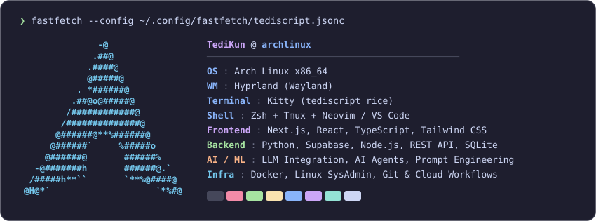

<div align="center">
  
</div>

<br />

<div align="center">
  
</div>

<br />

<!-- CLI Social Flags & Profile Views -->
<div align="center">
  <a href="https://github.com/TediKun">
    
  </a>
  <a href="https://github.com/TediKun">
    
  </a>
  <a href="https://linkedin.com">
    
  </a>
  <a href="mailto:tedi@example.com">
    
  </a>
  
</div>

---

### `❯ btop --monitor contributions & stats`

<div align="center">
  <!-- Contribution Snake Animation (Generated via GitHub Actions) -->
  <picture>
    <source media="(prefers-color-scheme: dark)" srcset="https://raw.githubusercontent.com/TediKun/TediKun/output/github-contribution-grid-snake-dark.svg" />
    <source media="(prefers-color-scheme: light)" srcset="https://raw.githubusercontent.com/TediKun/TediKun/output/github-contribution-grid-snake-dark.svg" />
    
  </picture>
</div>

<br />

<div align="center">
  <!-- 30-Day Activity Graph -->
  
</div>

<br />

<div align="center">
  <!-- GitHub Streak & Stats Cards -->
  
  
</div>

<div align="center">
  
</div>

---

### `❯ tree ./tech-stack`

```text
./tech-stack
├── frontend-mobile/
├── backend-database/
└── devops-sysadmin/
```

**`├── frontend-mobile/`**
<p>
  
  
  
  
  
  
  
  
  
</p>

**`├── backend-database/`**
<p>
  
  
  
  
  
</p>

**`└── devops-sysadmin/`**
<p>
  
  
  
  
  
  
</p>

---

### `❯ docker ps --format "table {{.Names}}\t{{.Image}}\t{{.Status}}"`

| CONTAINER NAME | STACK / IMAGE | DESCRIPTION | STATUS |
| :--- | :--- | :--- | :--- |
| **`tribook-web`** | `Next.js • Supabase • Tailwind` | Personal reading & writing platform for essays, monologues, and book reviews | `Up & Running` |
| **`coolinvest-app`** | `Next.js • Supabase RLS • Vercel` | Financial news & educational blog web application (`CInvest`) | `Up & Running` |
| **`tediscript-portfolio`** | `Next.js • Git JSON CMS • Tailwind` | Modular Bento-box developer portfolio with Hyprland/Kitty terminal aesthetic | `Up & Running` |
| **`pra-coffe-pos`** | `React • Next.js • API Routes` | Full-stack self-service coffee shop ordering & cashier POS system | `Completed` |
| **`habit-rpg-android`** | `React Native • SQLite` | Gamified Android habit tracker with RPG progression, boss battles & coin rewards | `Completed` |
| **`expense-tracker-app`** | `React Native • Expo • SQLite` | Personal expense tracker mobile app with visual analytics & category budgets | `Completed` |

---

### `❯ tail -f /var/log/wakatime.log`

<!--START_SECTION:waka-->
```text
[INFO] Waiting for WakaTime weekly sync...
[HINT] Add WAKATIME_API_KEY in Repository Secrets to enable automated coding metrics.
```
<!--END_SECTION:waka-->
