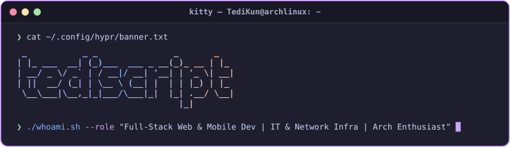

  

 

  

 

---

### Tech Stack & Skills

  <!-- AI, Data & Core -->
  
    
  <!-- Full-Stack Web -->
  
    
  <!-- OS & Cloud Infrastructure -->
  

---

### GitHub Metrics & Activity

<!-- 1. Contribution Snake -->

  <picture>
    <source media="(prefers-color-scheme: dark)" srcset="https://raw.githubusercontent.com/TediKun/TediKun/output/github-contribution-grid-snake-dark.svg" />
    <source media="(prefers-color-scheme: light)" srcset="https://raw.githubusercontent.com/TediKun/TediKun/output/github-contribution-grid-snake-dark.svg" />
    
  </picture>

 

<!-- 2. 30-Day Activity Graph (Full Width) -->

  

 

<!-- 3. Grid Table: Stats + Top Languages + Streak -->
<table align="center" width="100%" style="border-collapse: collapse; border: none;">
  <tr>
    <td align="center" width="50%" style="border: none; padding: 6px;">
      
    </td>
    <td align="center" width="50%" style="border: none; padding: 6px;">
      
    </td>
  </tr>
  <tr>
    <td colspan="2" align="center" style="border: none; padding: 6px;">
      
    </td>
  </tr>
</table>

---

### Featured Projects

| Project | Tech Stack | Description | Status |
| :--- | :--- | :--- | :---: |
| **`tribook-web`** | `Next.js • Supabase • Tailwind` | Personal reading & writing platform for essays, monologues, and book reviews | `Active` |
| **`coolinvest-app`** | `Next.js • Supabase RLS • Vercel` | Financial news & educational blog web application (`CInvest`) | `Active` |
| **`tediscript-portfolio`** | `Next.js • Git JSON CMS • Tailwind` | Modular Bento-box developer portfolio with Hyprland/Kitty aesthetic | `Active` |
| **`pra-coffe-pos`** | `React • Next.js • API Routes` | Full-stack self-service coffee shop ordering & cashier POS system | `Completed` |
| **`habit-rpg-android`** | `React Native • SQLite` | Gamified Android habit tracker with RPG progression & rewards | `Completed` |
| **`expense-tracker-app`** | `React Native • Expo • SQLite` | Personal expense tracker mobile app with visual analytics & category budgets | `Completed` |
